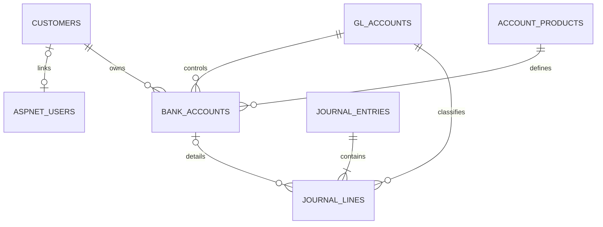

# BankLab Database Design — Cash Deposit

ဒီ design က roadmap ပတ် ၃ ရဲ့ ledger ERD နဲ့ ပတ် ၄ ရဲ့ EF Core migration အတွက် အခြေခံပါ။ Lab currency တစ်မျိုးနဲ့ ငွေသားသွင်းမှုကနေ စမယ်။ Customer တစ်ဦးက တစ်ဦးပိုင် bank account အများကြီး ဖွင့်နိုင်တယ်။

## Tables နှင့် relationships

| Table | စတင်သုံးမည့် columns | ဘာကြောင့် ရှိလဲ |
|---|---|---|
| Customers | CustomerId (PK), FullName | Account ပိုင်ရှင်ကို သိမ်းတယ်။ |
| AccountProducts | AccountProductId (PK), ProductCode (unique), Name | Savings လို account အမျိုးအစားကို account တစ်ခုချင်းစီမှာ ထပ်မရေးဘဲ သတ်မှတ်တယ်။ |
| BankAccounts | BankAccountId (PK), CustomerId (FK), AccountProductId (FK), DepositGlAccountId (FK), AccountNumber (unique), Status | Customer ရဲ့ account တစ်ခုကို ကိုယ်စားပြုတယ်။ ငွေသွင်းလက်ကျန်အတွက် ဘယ် deposit GL control account သုံးလဲ မှတ်ထားတယ်။ |
| GlAccounts | GlAccountId (PK), AccountCode (unique), Name, AccountType | Vault Cash လို asset account နဲ့ Customer Deposits လို liability account ကို သတ်မှတ်တယ်။ |
| JournalEntries | JournalEntryId (PK), BusinessDate (date), PostedAtUtc (datetime2), Description | ငွေသွင်းမှုတစ်ခုရဲ့ debit/credit lines တွေကို journal တစ်ခုအဖြစ် စုတယ်။ ဒီ table မှာ post ပြီးသား entries သိမ်းမယ်။ |
| JournalLines | JournalEntryId (FK), LineNo, GlAccountId (FK), BankAccountId (nullable FK), Side, Amount (decimal(19,2)) | Debit သို့ credit တစ်ကြောင်းစီနဲ့ သက်ဆိုင်တဲ့ GL account ကို သိမ်းတယ်။ Customer deposit line ဖြစ်ရင် သက်ဆိုင်တဲ့ bank account ပါ ချိတ်တယ်။ PK က (JournalEntryId, LineNo) ဖြစ်တယ်။ |

**BankAccount နဲ့ GlAccount ကွာပုံ**။ အကောင့် A-001 နဲ့ A-002 က customer subledger accounts တွေဖြစ်ပြီး Customer Deposits က GL control account ပါ။ Deposit line တစ်ကြောင်းမှာ GL account နဲ့ Customer Account နှစ်ခုလုံး ချိတ်ထားလို့ GL report က GL account အလိုက်၊ customer statement က BankAccountId အလိုက် အဲဒီ row ကိုပဲ စုတွက်နိုင်တယ်။

## Identity users နှင့် Customer ownership

| Table | BankLab မှာ ဘာကို ကိုယ်စားပြုလဲ |
|---|---|
| `AspNetUsers` | Sign in လုပ်တဲ့ user။ ASP.NET Core Identity က username၊ password hash နဲ့ lockout အချက်အလက်ကို စီမံတယ်။ |
| `AspNetRoles` / `AspNetUserRoles` | `Customer`၊ `Teller`၊ `Auditor` လို role နဲ့ ဘယ် user ကို ဘယ် role ပေးထားသလဲ သိမ်းတယ်။ |
| `Customers` / `BankAccounts` | Banking customer နှင့် ထို customer ပိုင် deposit accounts ကို သိမ်းတယ်။ |

Lab မှာ customer တစ်ဦးကို online login အများဆုံး တစ်ခု ချိတ်မယ်။ `ApplicationUser : IdentityUser` မှာ nullable `CustomerId` ထည့်ပြီး `AspNetUsers.CustomerId` ကို `Customers.CustomerId` ဆီ FK ချိတ်ပါ။ CustomerId ပါတဲ့ rows အတွက် unique index သတ်မှတ်ပါ။ Teller နဲ့ auditor login တွေမှာ CustomerId ကို NULL ထားနိုင်တယ်။ Branch မှာ အကောင့်ဖွင့်ထားတဲ့ customer ကလည်း online login မဖွင့်ရသေးဘဲ ရှိနိုင်တယ်။ Account တစ်ခုချင်းစီရဲ့ ပိုင်ရှင်ကို `BankAccounts.CustomerId` က ဖော်ပြတယ်။ [ASP.NET Core Identity model customization](https://learn.microsoft.com/en-us/aspnet/core/security/authentication/customize-identity-model) · [EF Core indexes](https://learn.microsoft.com/en-us/ef/core/modeling/indexes)

BankLab အစပိုင်းမှာ `ApplicationUser` နဲ့ `BankLabDbContext : IdentityDbContext<ApplicationUser>` ကို Infrastructure ထဲထားပြီး SQL Server database တစ်ခု၊ DbContext တစ်ခု သုံးမယ်။ အဲဒီ context က Identity tables နဲ့ banking tables နှစ်မျိုးလုံး map လုပ်နိုင်လို့ CustomerId FK ကို EF Core migration ထဲမှာ စီမံလို့ရတယ်။ Customer နဲ့ JournalEntry ကို Domain project မှာထားမယ်။

**Customer portal flow**။ မအေး sign in ဝင်ရင် backend က authenticated user ID အပေါ်မူတည်ပြီး CustomerId ကို ရှာမယ်။ Request ထဲက AccountId ကို `BankAccounts.CustomerId` နဲ့ တိုက်စစ်ပြီး ပိုင်တဲ့ account ကိုပဲ ပြမယ်။ Staff access ကို role နှင့် သက်ဆိုင်ရာ policy ဖြင့် သီးခြားစစ်မယ်။ Customer က A-001 ကိုပိုင်ပြီး B-001 ကို မပိုင်တဲ့ fixture နဲ့ စမ်းပါ။

Identity configuration နဲ့ authorization tests ကို roadmap ပတ် ၁၂ မှာ အပြည့်လုပ်မယ်။ ဒီအပိုင်းက schema design ဖြစ်ပြီး Identity tables မဖန်တီးရသေးပါ။

## Table တစ်ခုချင်းစီ၏ Column များ

ပထမ cash-deposit lab အတွက် SQL Server schema အဆိုပြုချက်ပါ။ Banking IDs ကို `bigint` သုံးပြီး Identity user/role ID ကို framework ရဲ့ default string key အတိုင်း ထားမယ်။ `NULL` လို့ ရေးထားတဲ့ column တွေမှာ တန်ဖိုးမပါလို့ရပါတယ်။ ကျန် banking columns တွေက required ပါ။

### ၁။ Customers

| Column | SQL Server type | အသုံး |
|---|---|---|
| CustomerId | bigint IDENTITY | PK။ ဘဏ်ရဲ့ customer ID။ |
| FullName | nvarchar(200) | Customer နာမည်။ |

### ၂။ AccountProducts

| Column | SQL Server type | အသုံး |
|---|---|---|
| AccountProductId | bigint IDENTITY | PK။ |
| ProductCode | nvarchar(32) | Unique။ ဥပမာ SAVINGS။ |
| Name | nvarchar(100) | UI မှာ ပြမယ့် product နာမည်။ |

### ၃။ BankAccounts

| Column | SQL Server type | အသုံး |
|---|---|---|
| BankAccountId | bigint IDENTITY | PK။ Journal line မှာ သုံးမယ့် internal ID။ |
| CustomerId | bigint | FK → Customers။ ပိုင်ရှင် ID။ |
| AccountProductId | bigint | FK → AccountProducts။ Savings လို product အမျိုးအစား။ |
| DepositGlAccountId | bigint | FK → GlAccounts။ Deposit liability ကို စုတွက်မယ့် GL control account။ |
| AccountNumber | nvarchar(32) | Unique။ ဥပမာ A-001။ ရှေ့က သုညတွေကို ထိန်းနိုင်ဖို့ text သုံးတယ်။ |
| Status | tinyint | Active = 1၊ Frozen = 2၊ Closed = 3။ Allowed values ကို CHECK နဲ့ ကန့်သတ်မယ်။ |

### ၄။ GlAccounts

| Column | SQL Server type | အသုံး |
|---|---|---|
| GlAccountId | bigint IDENTITY | PK။ |
| AccountCode | nvarchar(32) | Unique GL code။ ဥပမာ 1000 = Vault Cash၊ 2000 = Customer Deposits။ |
| Name | nvarchar(100) | GL account နာမည်။ |
| AccountType | tinyint | Asset = 1၊ Liability = 2၊ Equity = 3၊ Income = 4၊ Expense = 5။ Allowed values ကို CHECK နဲ့ ကန့်သတ်မယ်။ |

### ၅။ JournalEntries

| Column | SQL Server type | အသုံး |
|---|---|---|
| JournalEntryId | bigint IDENTITY | PK။ Posting တစ်ခုရဲ့ ID။ |
| BusinessDate | date | ဘဏ်စာရင်းမှာ သတ်မှတ်ထားတဲ့ လုပ်ငန်းရက်။ |
| PostedAtUtc | datetime2(3) | စာရင်းတင်လိုက်တဲ့ အချိန်ကို UTC ဖြင့် သိမ်းတယ်။ |
| Description | nvarchar(250) | ဥပမာ Cash deposit။ |

### ၆။ JournalLines

| Column | SQL Server type | အသုံး |
|---|---|---|
| JournalEntryId | bigint | FK → JournalEntries။ LineNo နဲ့ တွဲပြီး composite PK ဖြစ်တယ်။ |
| LineNo | int | Journal တစ်ခုအတွင်း line အစဉ် 1၊ 2 စသည်။ CHECK > 0။ |
| GlAccountId | bigint | FK → GlAccounts။ ဘယ် GL account ကို debit သို့ credit လုပ်လဲ။ |
| BankAccountId | bigint NULL | Customer deposit line မှာ BankAccounts ID ထည့်တယ်။ Vault Cash line မှာ NULL ထားတယ်။ |
| Side | tinyint | Debit = 1၊ Credit = 2။ CHECK ဖြင့် ကန့်သတ်မယ်။ |
| Amount | decimal(19,2) | Positive amount။ CHECK > 0။ Debit/Credit ဘက်ကို Side က သတ်မှတ်တယ်။ |

Ledger report နဲ့ customer statement ကို အဲဒီ JournalLines တွေကနေ ထုတ်ပါ။ Bank account တစ်ခုရဲ့ deposit ကို post လုပ်တဲ့အခါ customer bank account ID နဲ့ deposit GL ID တွဲဖက်မှုကို အောက်က constraints အတိုင်း စစ်ပါ။

### ၇။ ASP.NET Core Identity tables

အောက်ကစာရင်းက username/password နဲ့ roles သုံးတဲ့ Identity model ရဲ့ အခြေခံ tables ပါ။ Framework columns၊ key lengths နဲ့ indexes အတိအကျကို migration နဲ့ model snapshot ထုတ်တဲ့အခါ စစ်ပါ။ BankLab က ကိုယ်တိုင်ထည့်မယ့် column က `AspNetUsers.CustomerId` ဖြစ်ပါတယ်။ [Microsoft Identity model configuration](https://learn.microsoft.com/en-us/aspnet/core/security/authentication/customize-identity-model)

| Table | Columns နှင့် keys | အသုံး |
|---|---|---|
| AspNetUsers | Id (string PK), UserName, NormalizedUserName, Email, NormalizedEmail, EmailConfirmed, PasswordHash, SecurityStamp, ConcurrencyStamp, PhoneNumber, PhoneNumberConfirmed, TwoFactorEnabled, LockoutEnd, LockoutEnabled, AccessFailedCount, **CustomerId (bigint NULL, FK)** | Login နဲ့ account security settings။ CustomerId ပါတဲ့ rows အတွက် filtered unique index ထားမယ်။ |
| AspNetRoles | Id (string PK), Name, NormalizedName, ConcurrencyStamp | Customer၊ Teller၊ Auditor လို role definitions။ |
| AspNetUserRoles | UserId (FK), RoleId (FK)။ နှစ်ခုတွဲ PK။ | User ကို role တစ်ခု သို့မဟုတ် အများကြီး ပေးထားပုံ။ |
| AspNetUserClaims | Id (int PK), UserId (FK), ClaimType, ClaimValue | User တစ်ဦးချင်းစီနဲ့ ချိတ်ထားတဲ့ claims။ |
| AspNetRoleClaims | Id (int PK), RoleId (FK), ClaimType, ClaimValue | Role တစ်ခုနဲ့ ချိတ်ထားတဲ့ claims။ |
| AspNetUserLogins | LoginProvider, ProviderKey (နှစ်ခုတွဲ PK), ProviderDisplayName, UserId (FK) | External login provider ကို အသုံးပြုရင် Identity user နဲ့ ချိတ်ပေးတယ်။ |
| AspNetUserTokens | UserId (FK), LoginProvider, Name (သုံးခုတွဲ PK), Value | Identity token store မှာ သိမ်းဖို့ သတ်မှတ်ထားတဲ့ user tokens။ |

## ငွေသား ၁,၀၀၀.၀၀ သွင်းသည့် fixture

မအေးရဲ့ Savings account A-001 ကို လက်ကျန် ၀.၀၀ ကနေ စပါ။ GL accounts အနေနဲ့ Vault Cash (Asset) နဲ့ Customer Deposits (Liability) ရှိရမယ်။ Cash deposit တစ်ခုကို journal header တစ်ကြောင်းနဲ့ အောက်က lines နှစ်ကြောင်းအဖြစ် ရေးပါ။

| Journal | Line | GL account | Customer account | Side | Amount |
|---|---:|---|---|---|---:|
| J-001 | 1 | Vault Cash | NULL | Debit | 1,000.00 |
| J-001 | 2 | Customer Deposits | A-001 | Credit | 1,000.00 |

Vault Cash ရဲ့ debit balance ၁,၀၀၀.၀၀၊ Customer Deposits ရဲ့ credit balance ၁,၀၀၀.၀၀၊ A-001 ရဲ့ ledger balance ၁,၀၀၀.၀၀ ဖြစ်မယ်။ A-001 အတွက် credit စုစုပေါင်းထဲက debit စုစုပေါင်း နုတ်ပြီး balance တွက်ပါ။

## Database နဲ့ application မှာ စစ်ရမည့်အချက်များ

- Database မှာ PK/FK၊ AccountNumber/ProductCode/AccountCode uniqueness၊ Amount > 0 နဲ့ Side သည် Debit သို့ Credit ဆိုတဲ့ row-level constraints သတ်မှတ်ပါ။
- Customer deposit line မှာ BankAccountId ပါရမယ်။ ပါလာတဲ့ BankAccountId နဲ့ GlAccountId အတွဲက BankAccounts ရဲ့ (BankAccountId, DepositGlAccountId) နဲ့ ကိုက်ရမယ်။ Composite foreign key သုံးဖို့ referenced အတွဲကို unique key သတ်မှတ်နိုင်တယ်။ Deposit GL အတွက် BankAccountId မပါသည့် line ကို posting rule က ပယ်ရမယ်။
- Domain က line အနည်းဆုံး ၂ ကြောင်း၊ debit စုစုပေါင်း = credit စုစုပေါင်း စစ်မယ်။ Journal header နဲ့ lines အားလုံးကို database transaction တစ်ခုထဲ သိမ်းပါ။ SQL row-level CHECK က line တစ်ကြောင်းစီရဲ့ တန်ဖိုးကို စစ်နိုင်တယ်။ Journal တစ်ခုလုံးရဲ့ စုစုပေါင်းကို posting အဆင့်မှာ စစ်ပါ။
- Posted lines ကနေ ledger balance ထုတ်ပါ။ လွှဲပြောင်းမှုနဲ့ ပြိုင်တူငွေထွက်မှု စမ်းမယ့်အဆင့်မှာ balance projection၊ holds နဲ့ concurrency control ထပ်ဒီဇိုင်းလုပ်မယ်။

## ပထမဆုံး migration အတွက် acceptance checks

- [ ] Seed လုပ်ထားတဲ့ customer၊ Savings product၊ A-001 နှင့် GL accounts နှစ်ခုကို query လုပ်လို့ရသည်။
- [ ] Valid deposit တစ်ခုမှာ header ၁ ကြောင်းနှင့် lines ၂ ကြောင်း ရှိပြီး debit နဲ့ credit တစ်ဖက်စီ ၁,၀၀၀.၀၀ ဖြစ်သည်။
- [ ] Debit ၁,၀၀၀.၀၀၊ credit ၉၀၀.၀၀ ကို ပယ်ပြီး journal header နှင့် lines တစ်ကြောင်းမှ commit မဖြစ်ပါ။
- [ ] A-001 statement ရဲ့ လက်ကျန်နဲ့ Customer Deposits control စာရင်းမှာ fixture အတိုင်း ၁,၀၀၀.၀၀ ဖြစ်သည်။

[BankLab Roadmap](Banking-System-Engineering-Roadmap.md)
